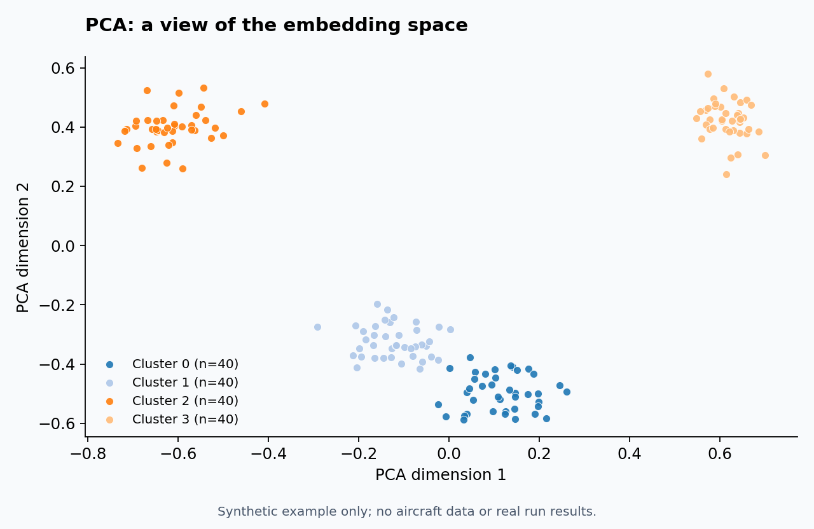
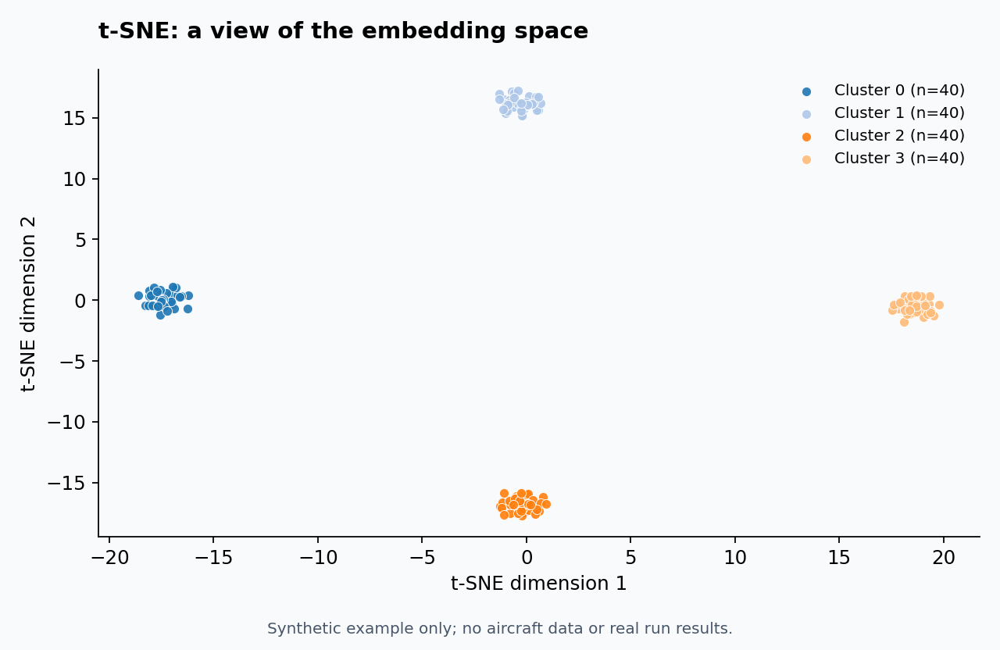

# Aircraft clustering with DINO

This project groups aircraft detections by visual similarity. YOLOv7 finds the objects, a frozen DINO model turns each accepted instance into a feature vector, and K-Means groups those vectors. The cluster galleries let you inspect what ended up together.

There are no subclass labels or training steps. A cluster number does not identify an aircraft type: a group can also reflect orientation, shadows, background, or image quality.

## Getting started

Keep your existing YOLOv7 workspace alongside this project. The detector adapter imports its loader, letterboxing, NMS, and coordinate scaling directly; it does not modify that workspace.

Install the dependencies in an environment with a suitable PyTorch and torchvision build:

```bash
python -m pip install -r requirements.txt
```

The detector workspace's dependencies also need to be available. Create a local config if you do not already have one:

```powershell
Copy-Item config.example.yaml config.yaml
```

Set `detector.workspace`, `detector.weights`, and `detector.image_dir` to your own paths. Use `recursive: false` to process only the chosen image folder, or `true` to include its subfolders. Set `target_class` to the class ID used by your checkpoint.

Then run:

```bash
python main.py
```

All settings come from `config.yaml`; there are no command-line arguments. Relative paths are resolved against the config file. Set both devices to `cpu` if CUDA is unavailable. For a quick trial, set `detector.max_images` to a small number.

Each run needs an empty `output.directory`. Choose a new directory when comparing settings so the results from earlier runs remain available.

## Choosing the image region

```yaml
candidates:
  crop_mode: bbox
  reject_bbox_overlap: true
  crop_size: 112
  reject_other_objects: true
  padding_value: 114

dino:
  input_size: [224, 224]  # height, width
```

| Mode | What DINO sees | Optional rejection rule |
| --- | --- | --- |
| `bbox` | The tight detected rectangle, resized to the input height and width | `reject_bbox_overlap` rejects boxes that overlap another detection |
| `contextual` | A square centered on the detection, including nearby context | `reject_other_objects` rejects crops containing part of another detection |

In bbox mode, resizing can change the object's aspect ratio. `crop_size` and `padding_value` have no effect in this mode. Turn `reject_bbox_overlap` off to retain overlapping instances.

In contextual mode, `crop_size` is the minimum square size in original-image pixels. The square expands when needed to contain the whole object. If it extends past an image edge, the missing area is filled with `padding_value`: 0 is black, 114 is gray. This value is a pixel intensity, not a border width.

Both guards check detections from every class, exclude the candidate itself, and accept boxes that only touch at an edge. Bbox mode checks the original floating-point boxes; contextual mode checks the crop region. Interference details stay in the manifest even when a guard is disabled.

## Switching between normal and satellite DINO

Change this one field:

```yaml
dino:
  backbone: normal  # normal or satellite
  input_size: [224, 224]
  embedding_type: cls
```

| Setting | Backbone | Patch size | CLS or mean features | Combined features |
| --- | --- | --- | --- | --- |
| `normal` | DINOv2 ViT-B/14 | 14 | 768 | 1536 |
| `satellite` | DINOv3 ViT-L/16, SAT-493M | 16 | 1024 | 2048 |

Each input dimension must be divisible by the selected patch size. Both 112 and 224 work for either model. `embedding_type` accepts `cls`, `mean`, or `cls_mean`. Mean pooling uses patch tokens only, excluding DINOv3's register tokens.

The loader handles each model's normalization and resizing. Normal mode uses ImageNet normalization and bicubic interpolation. Satellite mode uses SAT-493M normalization and bilinear interpolation, following [Meta's instructions](https://github.com/facebookresearch/dinov3#pretrained-backbones-via-pytorch-hub). Both use antialiasing, frozen weights, evaluation mode, and L2-normalized output features.

For normal mode, set `dino.normal.repository` and `weights` to existing local files, or leave them null to download the official model. Satellite mode uses the Hugging Face checkpoint. Before its first run:

1. Accept the access conditions on the [satellite model page](https://huggingface.co/facebook/dinov3-vitl16-pretrain-sat493m).
2. Run `hf auth login` in your Python environment with an account that has access.
3. Set `backbone: satellite` and run the pipeline.

Satellite weights are downloaded and cached before detection starts. For an offline setup, use `local_files_only: true`, or point `dino.satellite.local_directory` to a downloaded Hugging Face model folder containing `config.json` and safetensors weights. A Torch Hub `.pth` file is not the format expected by this loader.

## Reading the results

K-Means runs on the full normalized feature vectors, using the `k`, `random_state`, and `n_init` in your config. It does not choose K automatically. If fewer than K instances survive filtering, the pipeline saves the available metadata and skips clustering with an explanation in `summary.json`.

The visualizations answer different questions:

- **Annotated images** show accepted, clustered detections on their original images. Images without valid clustered instances are skipped.
- **Cluster galleries** show the instances assigned to each cluster. Individual crops and paginated `gallery_000.png` contact sheets share a folder. Each thumbnail includes its source filename and instance ID. Gallery crops show the source region before DINO resizing.
- **Rejected-candidate images** show which detection interfered with a candidate and why it was rejected.

### PCA

PCA shows the two directions of greatest variance in the embeddings. Each point is an accepted instance, and its color is the K-Means cluster assignment. It is a useful overview, but compressing hundreds of feature dimensions into two can hide structure.



### t-SNE

t-SNE emphasizes local neighborhoods: instances with similar features may appear close together. The sizes of the groups and the distances between separate groups should not be read as direct measures of similarity. Perplexity is reduced automatically when the sample count is small, and the configured seed makes repeated runs more reproducible.



These two figures use the same synthetic embeddings to illustrate the plots. They contain no aircraft data or real run results. Regenerate them with `python docs/make_projection_examples.py`.

Your own plots are written to `visualizations/clustering_pca.png` and `clustering_tsne.png`, with matching CSV files containing instance IDs, cluster IDs, and 2D coordinates. **Neither projection is used to fit K-Means.** Colors are consistent across the plots, annotations, and galleries.

## Output files

```text
dino_analysis/
  candidates/                 accepted source crops
  embeddings/features.pt      features, IDs, and backbone metadata
  clustering/
    assignments.csv           cluster ID and centroid distance per instance
    cluster_centers.npy
    cluster_summary.csv
    kmeans.joblib
  visualizations/
    annotated_images/
    rejected_candidates/
    cluster_0/ ...             crops and contact sheets
    clustering_pca.png
    clustering_pca.csv
    clustering_tsne.png
    clustering_tsne.csv
  manifest.csv
  rejected_candidates.csv
  detections.json
  summary.json
```

Instance IDs connect the manifest, features, assignments, plots, and crops. The summary records counts, timings, the selected model and settings, and any warnings. `save_crops` and `save_embeddings` control their respective exports; features can still be extracted when crop saving is disabled.

## Code and checks

| File | Responsibility |
| --- | --- |
| `main.py` | Runs the pipeline and writes its summary |
| `runtime.py` | Reads and validates configuration; handles shared file I/O |
| `detector.py` | Adapts the external YOLOv7 implementation |
| `candidate_extractor.py` | Extracts regions and applies overlap guards |
| `feature_extractor.py` | Loads either backbone and extracts embeddings |
| `clustering.py` | Fits and exports K-Means |
| `visualization.py` | Writes annotations, galleries, PCA, and t-SNE |
| `tests/test_pipeline.py` | Checks geometry, filtering, preprocessing, mapping, and exports |

Run the tests with:

```bash
python -m unittest discover -s tests -v
```

The normal pretrained model has been checked end to end. Satellite loading, normalization, and token pooling have been checked with a local test model; the pretrained satellite weights still require account access before they can be verified here. More detail is in [VALIDATION.md](VALIDATION.md).

The detector adapter also handles a historical checkpoint layout where layers saved as `SAM` contain `max_like` and `avg_w`. It maps those loaded objects to the detector repository's matching `SpatialAttention1` implementation in memory, preserving their weights. It does not rewrite the checkpoint or detector source.

## What belongs in Git

The repository should contain source code, tests, dependency requirements, this documentation, `config.example.yaml`, and the two synthetic documentation figures. `.gitignore` uses an allowlist so new datasets, checkpoints, exports, or other files are ignored by default.

Your working `config.yaml` and `config.smoke.yaml` stay local, along with datasets, crops, embeddings, plots from actual runs, model weights, caches, environments, and editor settings. Ignoring a file does not delete it from disk.

Before committing, review the proposed files:

```bash
git status --short
git diff --cached --stat
```

Ignore rules do not remove files that Git already tracks. If you copy this project into an existing repository, check its tracked files too. No dataset or model weight is needed to run the synthetic tests.
